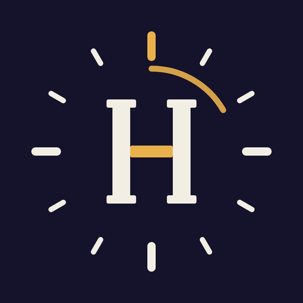

<p align="center"></p>

# Horae docs

The Horae website and documentation, published at **https://horae-dev.github.io/docs/**.

Part of [Horae](https://github.com/horae-dev), a predictable, self-hosted personal agent. The design documents
(ADRs, plan, design notes) live in the [core repository](https://github.com/horae-dev/horae).

## Work on it

```sh
python3 -m venv .venv && .venv/bin/pip install -r docs/requirements.txt
git clone https://github.com/horae-dev/horae core && .venv/bin/pip install ./core   # reference pages and CLI reference
.venv/bin/mkdocs serve          # http://127.0.0.1:8000/docs/
.venv/bin/mkdocs build --strict # what CI runs
```

Without `core/` (or `HORAE_CORE` pointing at a checkout), the generated reference pages are short stubs.

| Path | What |
|---|---|
| `docs/` | Markdown pages, styles (`stylesheets/horae.css`), the landing's dial (`javascripts/dial.js`), self-hosted fonts |
| `overrides/` | MkDocs Material overrides: `home.html` is the landing page |
| `hooks/core.py` | builds `reference/runtime.md`, `schemas.md`, `sdk.md` and `cli.md` from the core repository |
| `docs/videos/` | narrated canvas videos (canvas-video format): `script.json` is the narration, `scenes.js` the drawing, `horae/` the shared look, `timing.js` and `audio/` are generated |
| `PRODUCT.md`, `DESIGN.md` | product context and the design system ("The Hours Dial") |

Pushes to `main` deploy to GitHub Pages through `.github/workflows/docs.yml`.

### Videos

Four videos, each in English and French. Narration uses [Kokoro](https://huggingface.co/hexgrad/Kokoro-82M)
(Apache-2.0 voice weights). After editing a `script.json`, re-narrate with the canvas-video skill's `narrate.py`,
then check pronunciation with Whisper (`narration-lexicon`). Pronunciation fixes live in each video's
`lexicon.json`. CI fails when a script changed without re-narrating (`tools/narrate.py --check`, a copy of the skill script).

## License

[Apache-2.0](LICENSE). Fonts: Cormorant, Hanken Grotesk and JetBrains Mono, under the SIL Open Font License
(`docs/assets/fonts/`).
